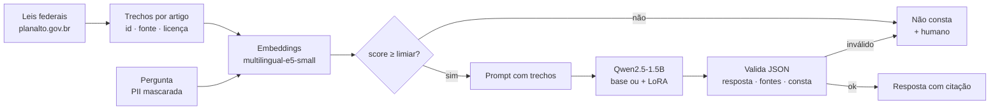

# Calçada Livre — Generative AI for Engineering · Global Solution 2026.2 · CitizenTech · FIAP ES 4º ano

Mapa vivo de barreiras de acessibilidade nas calçadas de São Paulo, alimentado por um carrinho inspetor, por fotos de cidadãos e por dados abertos.

## Integrantes
| Nome completo | RM |
|---|---|
| Carlos Ganzerli | 99840 |
| Paulo Lopes | 551137 |
| Lucas Bandeira | 98640 |
| Gustavo Melo Namura | 98809 |

## Ficha Técnica do MVP
| Campo | Conteúdo |
|---|---|
| **Nome do produto** | Calçada Livre |
| **Cidadão e território** | Pessoas com deficiência, idosos e mães com carrinho de bebê; calçadas do município de São Paulo (piloto em uma subprefeitura) |
| **Problema, em uma frase** | Pessoas com mobilidade reduzida deixam de sair de casa ou se machucam porque não sabem quais calçadas têm barreiras, e a prefeitura não tem um mapa atualizado delas |
| **Proposta de valor** | Um mapa único e atualizado de barreiras (obstáculos, buracos, degraus, trechos escuros), com triagem automática para a zeladoria e um assistente que explica direitos e normas em linguagem simples |
| **Arquitetura: componentes** | Carrinho inspetor (Maker Lab) · Foto do cidadão + detecção (Visão) · Assistente de dúvidas (GenAI) · Triagem automática (RPA) · Pipeline de dados (Big Data) · Mapa e painel (MVP) · Produção (DevOps) · Pitch (BI) |
| **Fontes de dados** | SP156 (pedidos de calçada, dados abertos da Prefeitura) · Open-Meteo (chuva) · IBGE (distritos) · ocorrências do próprio MVP (app, carrinho, visão) · leis federais de acessibilidade (planalto.gov.br) |
| **Modelos de IA utilizados** | Qwen2.5-1.5B-Instruct + LoRA com RAG (assistente) · multilingual-e5-small (busca) · YOLO nano (visão) · árvore de decisão embarcada (carrinho) |
| **URL do MVP e repositório** | URL: assistente local (FastAPI + Ollama), ver pasta api/ · Repositório: https://github.com/melo-zz/calcada-livre-genai |
| **Indicadores de impacto** | Barreiras mapeadas · % resolvidas em até 30 dias · dias até a resolução · km de rota acessível |
| **ODS conectados** | **ODS 11** (cidades inclusivas e acessíveis, metas 11.2 e 11.7) · **ODS 10** (redução das desigualdades) · **ODS 3** (saúde e bem-estar: menos quedas de idosos) |

### As seis perguntas do briefing
1. **Quem é o cidadão beneficiado?** Pessoas com mobilidade reduzida, idosos e responsáveis por crianças pequenas.
2. **Qual problema será resolvido?** Falta de informação confiável e atualizada sobre barreiras nas calçadas.
3. **Como a solução funcionará?** Toda barreira vira uma *ocorrência* na API central (tipo, local, foto, prioridade, status); RPA triagem e encaminha; Big Data cruza com chuva e demanda; o assistente explica direitos; o mapa mostra tudo.
4. **Quais tecnologias?** FastAPI, Postgres, Airflow, Databricks, LLM local com LoRA, YOLO, ESP32/Arduino, Docker, Terraform, GitHub Actions, Prometheus e Grafana.
5. **Quem participa do ecossistema?** Cidadãos, subprefeituras (zeladoria), concessionárias, shoppings, hospitais e campi (inspeção com o carrinho).
6. **Como medir e ampliar o impacto?** Indicadores acima; expansão por subprefeitura; receita por assinatura do painel de gestão.


**Tarefa da IA:** assistente que responde dúvidas do cidadão sobre acessibilidade e calçadas (leis federais), **cita o trecho** usado, **recusa** quando a resposta não está na base e explica a ocorrência detectada pelo carrinho/foto. Problema de **mobilidade**.

## Pipeline de IA


## Estrutura
| Pasta | Conteúdo |
|---|---|
| `docs/` | `RELATORIO.md` (relatório da entrega) e `img/` (gráficos) |
| `notebooks/` | 01 base e casos · 02 busca/recall/limiar · 03 treino LoRA · 04 placar e erros · 05 demonstração do vídeo (**com saídas salvas**) |
| `base/` | `trechos.jsonl` (1.258 trechos), `fontes.csv`, `tabela_fontes.md` |
| `fontes_html/` | cópia local das 8 leis (o site do planalto bloqueia o Colab) |
| `avaliacao/` | `casos.py`, `casos_teste.jsonl`, `recall.json`, `limiar.json/.png`, `placar.csv/.md/.png`, `interpretacao.md`, `erros.md`, `alucinacoes.md`, `loss_lora.png` |
| `src/` | código (base, busca, prompts, schema, pipeline, avaliação, LoRA) |
| `api/` | FastAPI + Ollama (`/perguntar`, `/explicar-ocorrencia`) |
| `tests/` | `pytest` (schema, limiar, LGPD, métricas, chunker) |

## Resultados (51 casos de teste: 41 "consta" e 10 "não consta")
| Configuração | JSON válido % | Acerto % | Recusa correta % | Alucinação % |
|---|---|---|---|---|
| A. Sem contexto | 88,2 | 17,1 | 10,0 | 88,2 |
| B. RAG simples | 95,1 | 70,7 | 90,0 | 19,6 |
| C. RAG + LoRA | 100,0 | 53,7 | 100,0 | 19,6 |

Busca: recall@1 = 0,61 e recall@3 = 0,85; limiar de "não consta" = 0,863. Detalhes, os 5 erros reais e a conclusão estão em [`docs/RELATORIO.md`](docs/RELATORIO.md).

**Vídeo de demonstração (2 a 3 min):** https://www.youtube.com/watch?v=QA1s17Hr8Qo

## Como reproduzir (seed fixa = 42)
1. Abra cada notebook de `notebooks/` no **Google Colab** com GPU T4 (Ambiente de execução → Alterar tipo → T4). O `REPO` da primeira célula já aponta para este repositório.
2. Rode **na ordem 01 → 02 → 03 → 04** (o 04 recria o limiar e treina o LoRA sozinho se não achar `modelo/lora_qwen15b`; o 05 é só a demonstração do vídeo).
3. O notebook 01 lê as leis da pasta `fontes_html/` (o planalto.gov.br bloqueia o Colab); se a pasta não existir, ele tenta o site e depois o Internet Archive.
4. Baixe cada notebook **com as saídas** (Arquivo → Fazer download → .ipynb) e faça commit em `notebooks/`.
5. Testes locais: `pip install -r requirements.txt && python -m pytest tests -q`.

### API local (integração com o MVP)
```bash
ollama pull qwen2.5:1.5b
uvicorn api.main:app --port 8000
curl -X POST localhost:8000/perguntar -H "Content-Type: application/json" -d '{"pergunta":"O que é desenho universal?"}'
curl -X POST localhost:8000/explicar-ocorrencia -H "Content-Type: application/json" -d '{"tipo_barreira":"degrau_sem_rampa"}'
```
A API devolve `resposta`, `fontes`, `consta`, `encaminhar_humano` (humano no circuito quando não consta) e os trechos usados (**explicável**). Nunca devolve o texto bruto do modelo nem dados pessoais.

## Segurança, LGPD e limites
- CPF, e-mail e telefone são mascarados **antes** de qualquer processamento ou registro (`src/textutil.py`, testado).
- Saída inválida do modelo nunca chega ao cidadão: vira "não encontrei" e é encaminhada a um humano.
- A base usa só textos de lei (domínio público). Normas da ABNT (NBR 9050) não têm licença aberta e **não** entram; perguntas que dependem delas são casos de "não consta".
- O assistente **não é aconselhamento jurídico**.


## Segurança e LGPD
Credenciais ficam em Airflow Variables, GitHub Secrets e `.env` local (no `.gitignore`). Nenhum dado pessoal real está no repositório: nomes, e-mails e telefones de quem reporta são **fictícios** e entram mascarados ou com hash na camada Ouro; a API do assistente mascara CPF, e-mail e telefone antes de processar qualquer pergunta.
