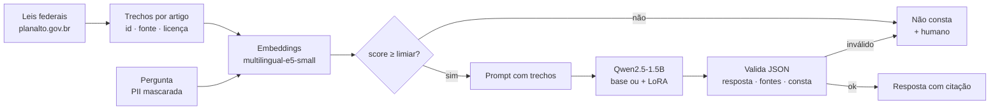

# Relatório — Generative AI for Engineering (Calçada Livre)

## 01. Integrantes
| Nome completo | RM |
|---|---|
| Carlos Ganzerli | 99840 |
| Paulo Lopes | 551137 |
| Lucas Bandeira | 98640 |
| Gustavo Melo Namura | 98809 |

## 02. Ficha Técnica
- **Produto:** Calçada Livre (mapa de barreiras de acessibilidade em calçadas de São Paulo).
- **Tarefa de IA:** assistente que responde dúvidas do cidadão sobre acessibilidade e calçadas com base em leis federais, **cita o trecho (id do artigo)**, **recusa ("não consta")** quando a base não responde e explica a ocorrência detectada pelo carrinho ou pela foto. Saída sempre em JSON: `{"resposta", "fontes", "consta"}`.
- **Modelos:** `Qwen/Qwen2.5-1.5B-Instruct` (gerador, Apache-2.0) e `intfloat/multilingual-e5-small` (busca semântica, MIT). Licenças conforme os *model cards* no Hugging Face.
- **Técnicas:** RAG (busca por embeddings + limiar de similaridade) e LoRA (r=16, alpha=32, 2 épocas, 480 exemplos gerados da própria base; os casos de teste não entram no treino).
- **Ambiente:** Google Colab com GPU T4, seed 42.
- **Segurança/LGPD:** PII mascarada antes de processar; saída validada por schema; humano no circuito quando "não consta".
- **Casos de teste:** 51 perguntas com gabarito (41 "consta na base" e 10 "não consta"), definidas em `avaliacao/casos.py`.

## 03. Diagrama do pipeline de IA

## 04. Tabela da base
A base é feita só de textos de leis e decretos federais (domínio público), quebrados **por artigo** (artigos longos são divididos em parágrafos). Cada trecho tem id, fonte, URL e licença. Notebook `notebooks/01_base_e_casos.ipynb`.

| Fonte | Formato | Licença | Nº de trechos |
|---|---|---|---|
| Lei 10.098/2000 - Acessibilidade | HTML (planalto.gov.br) | Domínio público (art. 8º, IV, Lei 9.610/1998: textos de leis e decretos) | 38 |
| Lei 13.146/2015 - Estatuto da Pessoa com Deficiência | HTML (planalto.gov.br) | Domínio público (art. 8º, IV, Lei 9.610/1998: textos de leis e decretos) | 201 |
| Lei 10.048/2000 - Atendimento prioritário | HTML (planalto.gov.br) | Domínio público (art. 8º, IV, Lei 9.610/1998: textos de leis e decretos) | 9 |
| Decreto 5.296/2004 - Regulamenta as Leis 10.048 e 10.098 | HTML (planalto.gov.br) | Domínio público (art. 8º, IV, Lei 9.610/1998: textos de leis e decretos) | 110 |
| Código de Trânsito Brasileiro | HTML (planalto.gov.br) | Domínio público (art. 8º, IV, Lei 9.610/1998: textos de leis e decretos) | 555 |
| Lei 10.741/2003 - Estatuto da Pessoa Idosa | HTML (planalto.gov.br) | Domínio público (art. 8º, IV, Lei 9.610/1998: textos de leis e decretos) | 138 |
| Lei 12.587/2012 - Política Nacional de Mobilidade Urbana | HTML (planalto.gov.br) | Domínio público (art. 8º, IV, Lei 9.610/1998: textos de leis e decretos) | 56 |
| Lei 13.709/2018 - LGPD | HTML (planalto.gov.br) | Domínio público (art. 8º, IV, Lei 9.610/1998: textos de leis e decretos) | 151 |
| **TOTAL** | | | **1258** |

## 05. Performance das configurações
**Busca (notebook 02):** recall@1 = **0,61** e recall@3 = **0,85** nos 41 casos "consta". O limiar de "não consta" ficou em **0,863** (acurácia balanceada **0,938**).

*Justificativa do limiar:* o gráfico mostra que quase todas as perguntas fora da base ficam abaixo de 0,863 (entre 0,78 e 0,86), enquanto as que constam se concentram entre 0,88 e 0,92. Há uma pequena sobreposição em torno de 0,86 a 0,89. Abaixo do limiar a resposta é "não consta" sem chamar o modelo, o que reduz alucinação e custo. Um limiar mais alto recusaria mais perguntas válidas e um mais baixo deixaria passar perguntas fora da base.

**Treino do LoRA (notebook 03):** 60 passos, loss de 0,096 para 0,0095, cerca de 12 minutos na T4.

**Placar (notebook 04)**: mesmo modelo, mesmos 51 casos, mesma seed.

| Configuração | JSON válido % | Acerto % | Recusa correta % | Citação correta % | Citação inventada % | Alucinação % |
|---|---|---|---|---|---|---|
| A. Sem contexto | 88,2 | 17,1 | 10,0 | 0,0 | 88,2 | 88,2 |
| B. RAG simples | 95,1 | **70,7** | 90,0 | **70,7** | 0,0 | 19,6 |
| C. RAG + LoRA | **100,0** | 53,7 | **100,0** | 56,1 | 0,0 | 19,6 |

**Interpretação:**
- **O RAG é o que mais reduz a alucinação.** Sem a base, o modelo responde 88,2% das perguntas com segurança, mas inventa a fonte em 88,2% delas e acerta 17,1%. Com a base, o acerto vai a 70,7%, nenhuma fonte é inventada e a alucinação cai para 19,6%.
- **O LoRA melhorou o formato e a recusa.** O JSON válido sobe de 95,1% para 100% e a recusa correta quando a pergunta não consta sobe de 90% para 100%.
- **O LoRA não melhorou o acerto.** Ele caiu de 70,7% para 53,7%, e a citação correta de 70,7% para 56,1%. Nossa hipótese é que, com só 480 exemplos de treino (360 "consta" e 120 "não consta"), o modelo ficou mais conservador e passou a recusar ou resumir demais perguntas que têm resposta. Também pesa a métrica, que é conservadora e exige o termo-chave do gabarito. Não testamos essa hipótese isoladamente.
- **Melhor configuração pelo critério do notebook** (menor alucinação, depois maior acerto): **B. RAG simples**. A configuração C é a mais segura no formato e na recusa.

**Demonstração de alucinações (sem contexto):** exemplos reais da configuração A, que respondeu com segurança e citou leis que não existem na base ou que não tratam do assunto:
- "O que são barreiras urbanísticas?" → o modelo citou "Lei Federal nº 10.439/2002 - Código Florestal" e "Lei Federal nº 8.666/1993 - Lei de Diretrizes Orçamentárias" (a 8.666 é a lei de licitações, e essa citação não tem relação com o tema).
- "As vias públicas e os parques precisam ser projetados de forma acessível?" → citou "Lei Federal nº 10.257/2001 - Lei das Condições de Trabalho" (a 10.257 é o Estatuto da Cidade) e um "Decreto nº 6.439/2008 - Plano Nacional de Acessibilidade" que não está na base consultada.
- "Vias públicas que já existem precisam ser adaptadas?" → afirmou "conforme determinado pela Lei Federal nº 13.796/2018", que não foi a lei consultada.
- "Estacionamentos em vias públicas precisam reservar vagas para PcD?" → citou a "Lei Federal 10.439/2002", que não trata disso.

Os exemplos completos estão na saída do notebook 04 (seção "Demonstração de alucinações").

**Definições das métricas:** `src/avaliacao.py`. *Acerto* é conservador: exige termo-chave do gabarito. *Alucinação* conta afirmar o que não consta, citar fonte inexistente ou afirmar sem o termo-chave.

## 06. Os 5 erros, a causa e a correção
Total de erros encontrados nas configurações B e C: 32. Escolhemos cinco com causas diferentes, todos reais (saída do notebook 04).

**Erro 1 (B. RAG simples) — formato.**
Pergunta: "O que a lei de acessibilidade entende por pessoa com mobilidade reduzida?" A busca trouxe o artigo certo (l13146_art53, score 0,9187), mas o modelo não respondeu em JSON válido e o sistema caiu na recusa ("Não encontrei essa informação na base consultada"). *Causa:* o modelo não respeitou o formato pedido. *Correção:* treinar com LoRA em exemplos no formato correto (o que a configuração C fez: 100% de JSON válido), usar decodificação restrita por schema ou uma tentativa de reparo.

**Erro 2 (B. RAG simples) — paráfrase fora do gabarito.**
Pergunta: "As vias públicas e os parques precisam ser projetados de forma acessível?" Resposta: "Sim, as vias públicas e os parques devem ser projetados de forma acessível conforme determina a legislação brasileira", citando l10098_art3, que é o artigo correto. *Causa:* a resposta é correta, mas não usa o termo do gabarito ("acessiveis"), então a métrica a conta como erro. *Correção:* gabarito com sinônimos ou um juiz (LLM ou humano) e pedir resposta mais extrativa.

**Erro 3 (B. RAG simples) — busca não trouxe o trecho certo.**
Pergunta: "O que significa acessibilidade segundo o Estatuto da Pessoa com Deficiência?" Os três trechos recuperados (l13146_art53, art1 e art79) não continham a definição esperada ("segurança e autonomia"), e o modelo respondeu com uma frase genérica. *Causa:* o trecho certo não veio no top-3. *Correção:* melhorar a recuperação com busca híbrida (BM25 + embeddings), aumentar k ou revisar o chunking.

**Erro 4 (B. RAG simples) — recusa indevida.**
Pergunta: "Quais as barreiras que o Estatuto classifica como urbanísticas?" O trecho mais próximo teve score 0,8542, abaixo do limiar 0,863, então o sistema respondeu "não consta", embora a informação esteja na base. *Causa:* o limiar rejeitou um caso válido, na faixa de sobreposição entre as classes. *Correção:* calibrar o limiar com mais casos, ou usar o limiar só como sinal e deixar o modelo decidir quando há trecho relevante.

**Erro 5 (B. RAG simples) — resposta a pergunta que não consta.**
Pergunta: "Quanto custa um cão-guia para pessoa com deficiência visual?" O trecho mais próximo (l13146_art117, score 0,8889) passou do limiar, e o modelo respondeu com uma explicação genérica sobre custos, citando um artigo que trata do direito ao cão-guia, não do preço. *Causa:* a pergunta não está na base, mas o sistema respondeu como se estivesse. *Correção:* calibrar o limiar com mais casos "não consta" e exigir que a resposta cite um trecho que de fato a sustente.

## 07. Conclusão técnica e links
- **O que funcionou:** a base de leis com RAG tirou o modelo da invenção. A alucinação caiu de 88,2% para 19,6%, e a citação inventada de 88,2% para 0%. O limiar de similaridade separou bem as perguntas fora da base (acurácia balanceada de 0,938), e o LoRA levou o formato JSON a 100% e a recusa correta a 100%.
- **O que não funcionou:** o LoRA reduziu o acerto de 70,7% para 53,7% e a citação correta de 70,7% para 56,1%. O recall@1 da busca é de só 0,61.
- **Limitações:** modelo pequeno (1,5B), base só com leis federais (sem normas municipais nem a NBR 9050), apenas 51 casos de teste, avaliação por termo-chave (conservadora) e um único treino com uma única seed.
- **Próximos passos:** busca híbrida BM25 + embeddings, mais casos de teste e mais exemplos de treino, revisão humana do gabarito, juiz humano ou LLM na avaliação e ajuste do LoRA para não perder acerto.
- **Reprodutibilidade:** rodar os notebooks `01` a `04` em ordem no Colab (GPU T4). Nenhum modelo ou segredo vai para o GitHub.
- Repositório: https://github.com/melo-zz/calcada-livre-genAi · Vídeo: https://www.youtube.com/watch?v=QA1s17Hr8Qo
